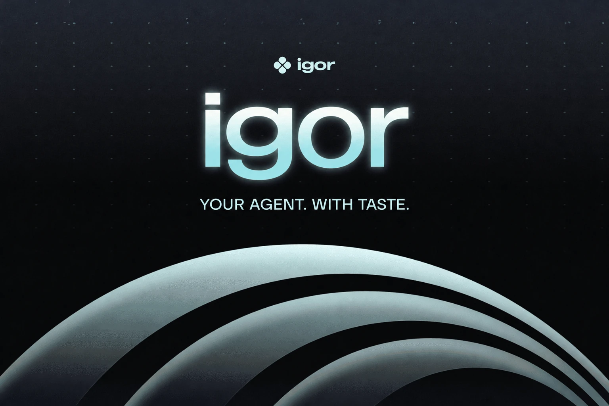

<p align="center">
  <a href="https://igor-production-243e.up.railway.app/app">
    
  </a>
</p>

<h3 align="center">AI agents are learning how to do almost anything.<br>But how do they know what's right for you?</h3>

<p align="center">
  Knowing <em>how</em> to do something isn't the same as understanding <em>what fits</em>.<br>
  Your taste. Your interests. Your people. Your constraints.
</p>

<p align="center">
  <a href="https://igor-production-243e.up.railway.app/app"><strong>Try Igor</strong></a>
  &nbsp;·&nbsp;
  <a href="#-a-real-igor-workflow">See the workflow</a>
  &nbsp;·&nbsp;
  <a href="qloo/README.md">Explore Qloo integration</a>
  &nbsp;·&nbsp;
  <a href="#-run-it-locally">Run locally</a>
</p>

---

## 💡 An AI agent with taste

You want to plan an evening with friends. One loves indie films. Another wants jazz. Two people disagree about dinner. You have a budget, a time limit, and plenty of opinions.

Ask a typical AI for help and you get a list.

**Now you have ten more things to argue about.**

Igor goes beyond the list. It's a conversational agent that uses [Qloo's Taste Graph](https://www.qloo.com/) to discover cultural connections, weigh preferences and constraints, and turn the result into editable work.

Plans, invitations, itineraries, creative briefs. One conversation that can keep evolving.

**Because a good recommendation is only useful if you can do something with it.**

## 🎬 A real Igor workflow

*The interesting part starts when you change your mind.*

In a documented Railway production check on **October 26, 2026**, Igor received this request:

> **“I like Portishead and Arrival. Find films for me for a quiet evening.”**

The result: **10 film references**, backed by **LIVE Qloo cultural evidence** retrieved in **2 Qloo requests**.

Then the operator said:

> **“Budget: 20.”**

Igor updated the constraint, retained the cultural reference pool, and made **0 new Qloo requests** for the correction.

| 10 film references | 2 live Qloo requests | 0 repeat Qloo requests on budget correction |
| :---: | :---: | :---: |
| Cultural discovery | Evidence-backed retrieval | Selective revision |

That's the experience we're building around: **discover once, preserve what matters, change what needs changing**.

[Read the original production verification](docs/live-integration.md) · [See the Qloo evidence breakdown](qloo/EVIDENCE.md) · [Open Igor](https://igor-production-243e.up.railway.app/app)

## 🧭 Try the judge walkthrough

1. **[Open the application](https://igor-production-243e.up.railway.app/app).** Start a fresh conversation and ask for film recommendations connected to Portishead and *Arrival*.
2. **Inspect the cultural evidence.** Look for source references and whether the result is marked `LIVE` or `CACHED`.
3. **Change your mind.** Enter `Budget: 20` and examine what changes in the saved task.
4. **Return to the conversation.** Reload the page and ask what you discussed earlier.
5. **Inspect the implementation.** The [Qloo dossier](qloo/README.md) connects provider calls, evidence, tests and limitations to the code.

This is a way to explore Igor's actual behavior, not a guaranteed reproduction of one dated provider result. The [production notes](docs/live-integration.md) record what happened in the October 26 runs.

## ✨ One agent. Four capabilities.

**🔎 Discover.** Cultural connections across films, artists, places and more, informed by Qloo.

**⚖️ Evaluate.** Compare the options against stated interests, budgets, practical facts and unknowns.

**🤝 Collaborate.** Keep people's tastes distinct. Find overlap without flattening everyone into one imaginary profile.

**🎨 Compose.** Turn chosen ideas into an invitation, a programme, an itinerary, a research report or a creative brief.

All four capabilities share conversation history, evidence and saved work.

## 🔗 Why Qloo matters

Qloo isn't a recommendation widget bolted onto Igor's interface. It is a source of cultural intelligence that the agent can use while deciding what to discover, compare and create.

**Qloo supplies cultural signals. Igor turns those signals into work.**

An affinity signal isn't proof of a venue's opening hours, current price or availability. Igor keeps cultural evidence separate from practical facts so the user can understand what supports each decision.

For the actual integration, start here:

- [How Qloo works inside Igor](qloo/README.md)
- [The request-to-revision flow](qloo/WORKFLOW.md)
- [Production evidence](qloo/EVIDENCE.md)
- [Evaluation protocol](qloo/EVALUATION.md)

## 🔄 Change the decision. Keep the work.

What if the budget changes after you've chosen a film? What if someone wants different music? What if you only want to edit the invitation?

Igor tracks the dependencies between cultural references, constraints and saved outputs. A budget change can reuse existing discovery; a changed cultural preference can trigger fresh exploration. An invitation edit shouldn't erase your earlier selections.

This connected-work model also supports a six-person gathering, a multi-day itinerary, an artist-level listening programme and reference-based creative research.

[See what the engine supports](docs/broader-outcomes.md) · [Read the architecture](docs/architecture.md)

## 🛠️ Under the hood

Igor is built with **Next.js, React, TypeScript, Node.js, SQLite** and typed capability contracts. The model interprets the conversation; server-side adapters handle cultural retrieval; the agent evaluates constraints and commits evidence-linked, versioned outcomes.

| Explore the source | Responsibility |
| :--- | :--- |
| [Agent orchestrator](src/core/orchestrator.ts) | Conversation, capability execution and persistent state |
| [Qloo adapter](src/tools/qloo-live.ts) | Cultural retrieval, caching and bounded requests |
| [Qloo response validation](src/tools/qloo-response.ts) | Entity normalization and evidence handling |
| [Capability contracts](src/capabilities/contract.ts) | Discover, Evaluate, Collaborate and Compose |
| [Architecture](docs/architecture.md) | Ownership, provenance and dependency-aware revisions |
| [Provider validation](docs/github-validation.md) | Independent checks and recorded outcomes |

Tests cover the capability contracts, provider boundaries, persistence, revisions and failure handling. See [the evaluation guide](qloo/EVALUATION.md) for runnable checks and the distinction between an executed test and a planned study.

## 💻 Run it locally

Use **Node.js 24+** and the [public source](https://github.com/Davemafy/ighor).

```bash
git clone https://github.com/Davemafy/ighor.git
cd ighor
npm ci
npm run dev
```

Open [localhost:3000/app](http://localhost:3000/app). Configure `QLOO_API_KEY` and a supported server-side model key, such as `GEMINI_API_KEY`, for live discovery and conversation.

```bash
npm test
npm run test:eval
npm run typecheck
npm run build
```

Original Qloo API recordings aren't redistributed in this public checkout because redistribution rights haven't been established; recording-dependent suites need authorized private fixtures. [Development setup](docs/development.md) covers provider configuration and test boundaries.

## 🔮 Where we're taking Igor next

More immersive cultural exploration, permission-based external coordination, deeper group collaboration, and a blinded study of how much Qloo improves real task outcomes.

## ❤️ Thank you, Qloo

Huge thanks to the **Qloo team** for organizing this hackathon and giving us the chance to build with the Taste Graph. An idea about agents with taste became an exploration of culture, decisions, memory and what comes after a recommendation.

**Thank you for making it possible. ❤️**

---

<p align="center">
  <strong>🕶️ Igor. Your agent with taste.</strong><br>
  <sub>Built with ❤️ for the Qloo Agentic Hackathon.</sub>
</p>

<p align="center"><strong>Knowing what to recommend is one thing. Knowing what to do with it is another.</strong></p>
