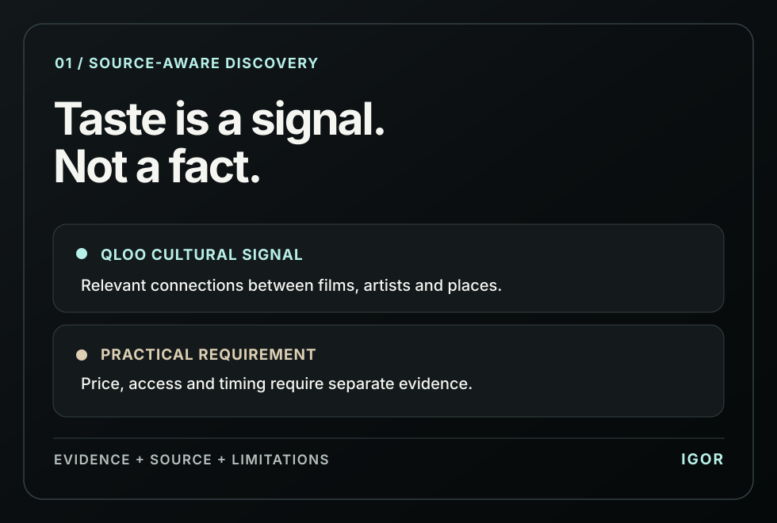
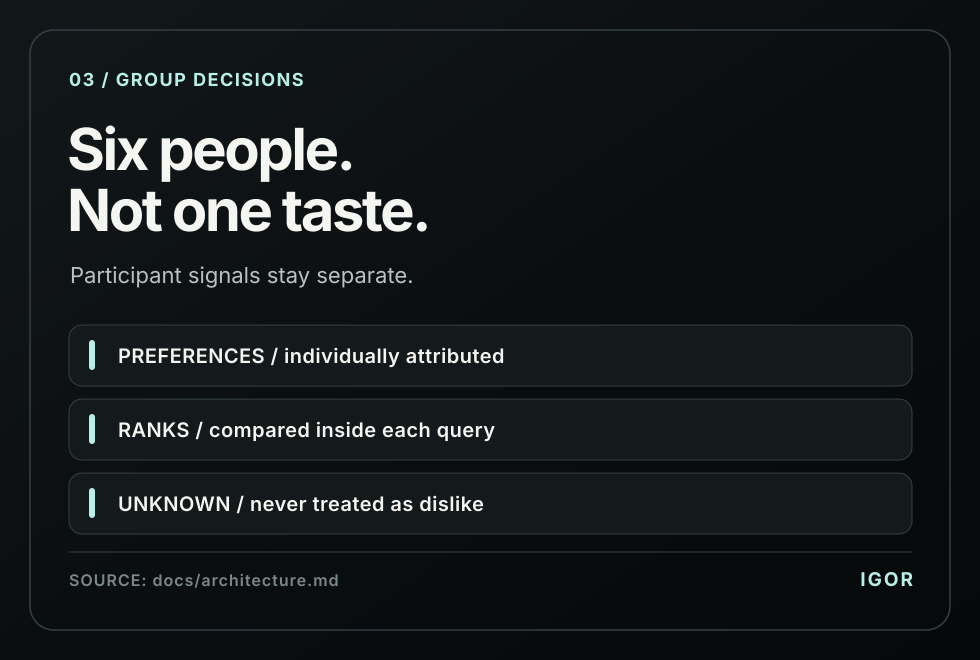
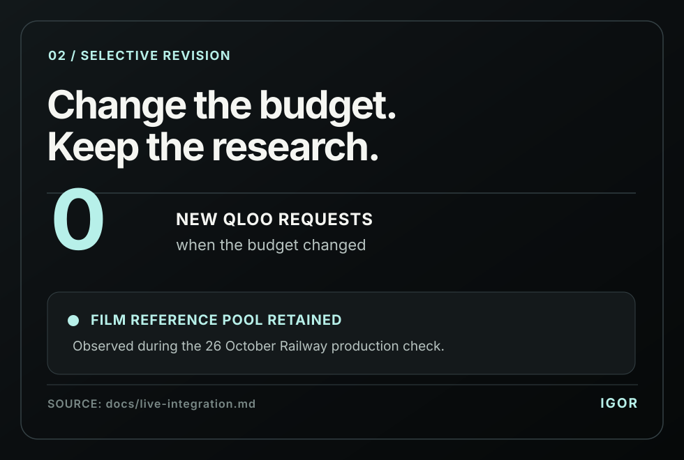
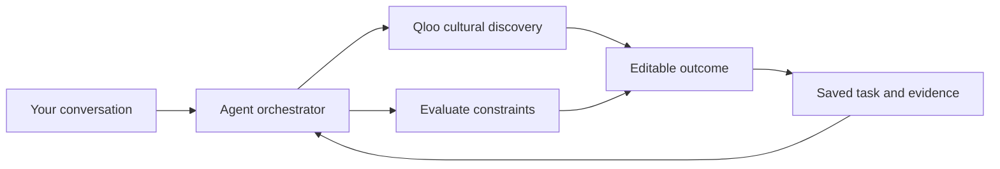

<p align="center">
  <a href="https://igor-production-243e.up.railway.app/app">
    
  </a>
</p>

<h3 align="center">AI agents are learning how to do almost anything.<br>But how do they know what's right for you?</h3>

<p align="center">
  Knowing <em>how</em> to do something isn't the same as understanding <em>what fits</em>.<br>
  Your taste. Your interests. Your people. Your constraints.
</p>

<p align="center">
  <a href="https://igor-production-243e.up.railway.app/app"><strong>Try Igor</strong></a>
  &nbsp;·&nbsp;
  <a href="#-see-igor-at-work">See it work</a>
  &nbsp;·&nbsp;
  <a href="#-get-started">Get started</a>
  &nbsp;·&nbsp;
  <a href="qloo/README.md">Qloo integration</a>
  &nbsp;·&nbsp;
  <a href="https://github.com/Davemafy/ighor">Source</a>
</p>

---

## 💡 Meet Igor

**What if your AI agent had taste?**

Not just the ability to suggest a film or find a restaurant, but the cultural understanding to connect your interests, make sense of different preferences, and turn ideas into something useful.

**Igor** is a conversational agent powered by [Qloo's Taste Graph](https://www.qloo.com/). Qloo provides cultural connections. Igor brings them into discovery, evaluation, group decisions, and editable work, all in one conversation.

And when you change your mind? **You don't have to start over.**

## 🎬 See Igor at work

*This isn't another list of recommendations. It's what happens after the list.*

In a documented Railway production check on **October 26, 2026**, an operator asked Igor for films connected to Portishead and *Arrival*. Igor returned ten film references with **LIVE Qloo evidence**. The operator then changed the budget. Igor updated the constraint, kept the film reference pool, and made **zero new Qloo requests** for that correction.

<p align="center">
  <a href="docs/live-integration.md">
    
  </a>
</p>

<sub>The graphic illustrates a recorded production check, rather than recreating an app screenshot. [Read the test evidence](docs/live-integration.md) or [open the application](https://igor-production-243e.up.railway.app/app).</sub>

## 🧭 Judge walkthrough

**Start with one conversation. Change one thing. See what Igor keeps.**

1. **[Open Igor](https://igor-production-243e.up.railway.app/app)** and begin a fresh conversation. Try: **“I like Portishead and Arrival. Find films for me for a quiet evening.”**
2. **Explore the evidence.** Inspect the returned cultural references and their Qloo source details. A `LIVE` label means a provider request; `CACHED` means reused evidence.
3. **Change a constraint.** Say **“Budget: 20.”** See whether the cultural pool is preserved and how the saved task responds.
4. **Check continuity.** Reload the conversation and ask Igor to recall your earlier request.
5. **Follow the receipts.** Open the [Qloo integration dossier](qloo/README.md) for the actual provider code, dated production checks, evaluation tooling, and source limitations.

These steps let judges explore the same *kind* of workflow as the October 26 production check. Live results may depend on provider configuration, cached data and the current runtime. The historical observations and their scope are in [qloo/EVIDENCE.md](qloo/EVIDENCE.md).

## ✨ Four capabilities. One agent.

- 🔎 **Discover:** Explore connections across films, artists, places, and other cultural references using Qloo.
- ⚖️ **Evaluate:** Consider preferences, known facts, budgets, time, and anything still unknown.
- 🤝 **Collaborate:** Compare people's stated tastes without pretending everyone agrees.
- 🎨 **Compose:** Turn selected ideas into editable plans, invitations, itineraries, and creative briefs.

**No separate assistant for every task. No throwing away a good idea when the brief changes.**

## 🧐 Why Igor makes different decisions

**Qloo is part of Igor's decisions, not a recommendation widget added at the end.** [See the source-level Qloo walkthrough](qloo/WORKFLOW.md).


<table>
<tr>
<td width="50%" valign="top">
  
  <p><strong>🔗 Show your sources.</strong><br>Qloo affinity helps Igor explore what fits. It doesn't magically verify prices, opening times, or whether someone will love the result. Igor keeps the signal, its source, and its limits together.</p>
</td>
<td width="50%" valign="top">
  
  <p><strong>🤝 Keep everyone's taste personal.</strong><br>A group isn't one taste profile. Igor preserves who's interested in what, compares signals within each query, and makes trade-offs visible instead of inventing a compatibility score.</p>
</td>
</tr>
</table>

### 🔄 Change the decision. Keep the work.

<p align="center">
  <a href="docs/live-integration.md">
    
  </a>
</p>

Change a budget and Igor can reconsider what depends on it, without restarting the cultural search. Edit an invitation and that shouldn't erase your film choices. Decisions, evidence, documents, and conversation history stay connected through versioned task state.

The same engine supports a six-person gathering, a multi-day itinerary, an artist-level listening programme, a cultural research report, and a reference-based creative brief. [See supported outcomes](docs/broader-outcomes.md).

## 🛠️ Inside Igor

The split matters: **Qloo provides cultural references. The agent chooses the work. Validated code checks constraints and revisions.** See the [root-level Qloo dossier](qloo/README.md) for the provider boundaries, dated evidence and evaluation approach.


We built Igor as a **Next.js and React** application with **TypeScript**, **SQLite**, typed task contracts, and server-side provider adapters. The interface and the agent work from the same saved state.



The agent interprets a request, chooses the relevant capabilities, checks evidence and constraints, then saves the result. Later changes invalidate dependent decisions while preserving unrelated work. Provider credentials remain on the server.

| Where to look | What you'll find |
| :--- | :--- |
| [Agent orchestration](src/core/orchestrator.ts) | Versioned turns, execution, and persistence |
| [Capability contracts](src/capabilities/contract.ts) | Typed discovery, evaluation, collaboration, and composition |
| [Qloo integration](src/tools/qloo-live.ts) | Cultural retrieval, identity handling, and bounded requests |
| [Qloo evidence](qloo/EVIDENCE.md) | Dated LIVE and CACHED provider checks with their limits |
| [Qloo evaluation](qloo/EVALUATION.md) | Blind comparison protocol, runnable tests and unmeasured outcomes |
| [Evidence and revision rules](docs/architecture.md) | Provenance, constraints, stale dependencies, and selective updates |
| [Development guide](docs/development.md) | Provider configuration and verification commands |

## 💻 Get started

[**Try the live app**](https://igor-production-243e.up.railway.app/app) or clone the [**public source code**](https://github.com/Davemafy/ighor).

Use **Node.js 24 or newer**:

```bash
git clone https://github.com/Davemafy/ighor.git
cd ighor
npm ci
npm run dev
```

Open [localhost:3000/app](http://localhost:3000/app). For live cultural retrieval and conversation, set `QLOO_API_KEY` and a supported server-side model key such as `GEMINI_API_KEY`.

```bash
npm test
npm run typecheck
npm run build
```

Original Qloo response recordings are not redistributed in this public checkout because their reuse rights have not been established. The recording-only replay suites require authorized fixtures. [Provider setup and test details](docs/development.md) explain the available paths. App results don't imply that a venue is booked, open, or affordable unless those facts have been supplied or independently checked.

### 🔍 Reproducibility and limits

The documented October 26 film-discovery run returned ten references with LIVE Qloo evidence. Its budget correction preserved the reference pool with zero additional Qloo requests. The verified discussion journey also restored saved conversation messages after a refresh. These observations are **dated execution evidence**, not a claim that this README commit has passed a fresh production acceptance run.

For test commands, current source boundaries, and the difference between a runnable unit suite and recording-dependent checks, see [Qloo evaluation](qloo/EVALUATION.md) and [provider verification](docs/github-validation.md). Results from a cached fixture aren't relabeled as live results.

## 🔮 What's next?

🗺️ Richer spatial discovery. 📬 Permission-based coordination. 🤝 More shared reviews and approvals. 📊 Comparing outcomes with and without Qloo.

## ❤️ Thank you, Qloo

Huge thanks to the **Qloo team** for organizing this hackathon and letting us experiment with the Taste Graph. What started as a question about whether AI agents could understand taste became a much bigger exploration of culture, decisions, and creative work.

**Thank you for making it possible. ❤️**

---

<p align="center">
  <strong>🕶️ Igor. Your agent with taste.</strong><br>
  <sub>Built with ❤️ for the Qloo Agentic Hackathon.</sub>
</p>

<p align="center"><strong>Knowing what to recommend is one thing. Knowing what to do with it is another.</strong></p>