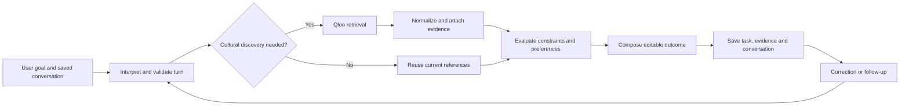
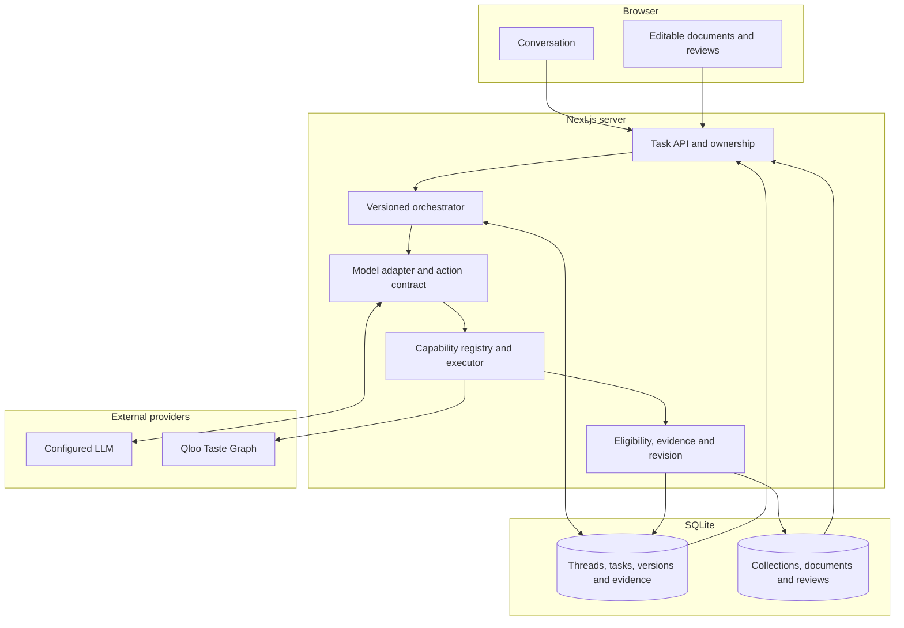
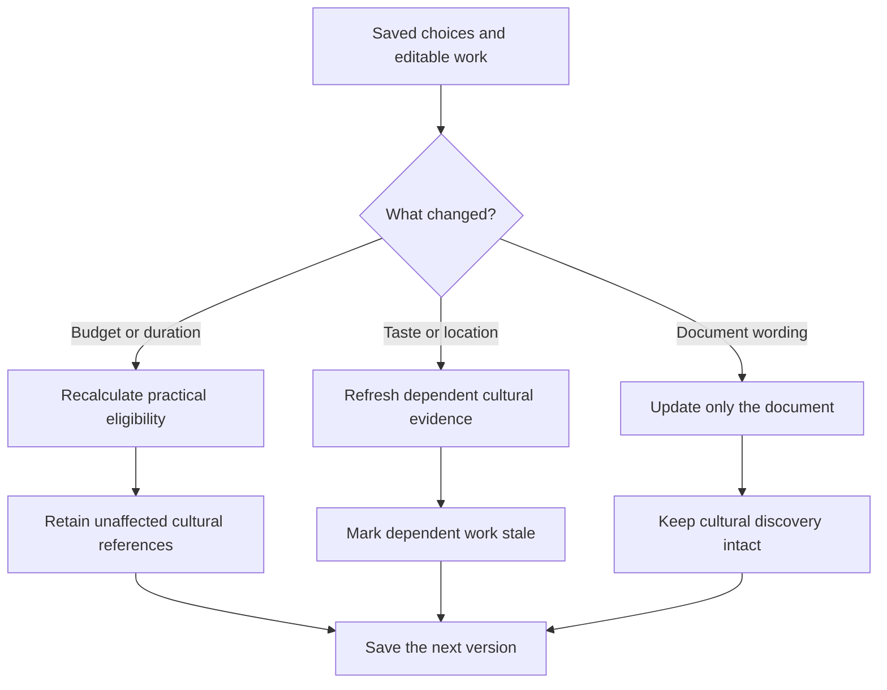

# Igor

**AI agents are learning how to do almost anything. But how do they know what's right for you?**

**Your agent with taste. Powered by [Qloo](https://www.qloo.com/).**

Igor connects cultural discovery to the decisions that follow it. It can compare different people's tastes, turn the result into editable work, and preserve that work when the conversation changes.

**[Live application](https://igor-production-243e.up.railway.app/app)** · **[Judge walkthrough](#judge-walkthrough)** · **[Qloo integration](qloo/README.md)** · **[Source code](src/core/orchestrator.ts)**

---

## Contents

- [The problem](#the-problem)
- [What Igor does](#what-igor-does)
- [How it works](#how-it-works)
- [Architecture](#architecture)
- [What the model does and what code enforces](#what-the-model-does-and-what-code-enforces)
- [Qloo integration](#qloo-integration)
- [Selective revision](#selective-revision)
- [A verified production run](#a-verified-production-run)
- [Judge walkthrough](#judge-walkthrough)
- [Supported outcomes](#supported-outcomes)
- [Running locally](#running-locally)
- [Testing and reproducibility](#testing-and-reproducibility)
- [Project layout](#project-layout)
- [Limitations](#limitations)

---

## The problem

You want to plan an evening with friends. One loves indie films. Another wants jazz. Two people disagree about dinner. You have a budget, a time limit, and plenty of opinions.

Ask a typical AI for help and you get a list.

**Now you have ten more things to argue about.**

Igor goes beyond the list. It's a conversational agent that uses [Qloo's Taste Graph](https://www.qloo.com/) to discover cultural connections, weigh preferences and constraints, and turn the result into editable work.

Plans, invitations, itineraries, creative briefs. One conversation that can keep evolving.

**Because a good recommendation is only useful if you can do something with it.**

## What Igor does

**🔎 Discover.** Cultural connections across films, artists, places and more, informed by Qloo.

**⚖️ Evaluate.** Compare the options against stated interests, budgets, practical facts and unknowns.

**🤝 Collaborate.** Keep people's tastes distinct. Find overlap without flattening everyone into one imaginary profile.

**🎨 Compose.** Turn chosen ideas into an invitation, a programme, an itinerary, a research report or a creative brief.

All four capabilities share conversation history, evidence and saved work.

## How it works



1. **Understand the goal.** The model interprets a free-form request using saved conversation context. It can propose an action, reply or clarification.
2. **Validate before executing.** The server checks action contracts, ownership, task version and available capabilities. Missing information is a question, not a fabricated answer.
3. **Discover with Qloo when relevant.** Cultural entities and connections are resolved through the Qloo provider. Existing evidence can be reused when a correction needs no cultural refresh.
4. **Evaluate and compose.** Cultural relevance is kept separate from the supplied facts needed to produce a feasible plan. The capability engine creates results and attaches supporting evidence.
5. **Persist and revise.** The next message sees the saved conversation, task dependencies, decisions and editable outcome.

[Full turn lifecycle](docs/architecture.md) · [Orchestrator source](src/core/orchestrator.ts)

## Architecture

Igor runs as one **Next.js App Router** application. The browser displays the saved workspace and submits edits; the server owns interpretation, cultural retrieval, capability execution, validation and persistent state.



| Boundary | Source | Responsibility |
| :--- | :--- | :--- |
| **UI and routes** | [`src/app/`](src/app/), [`src/components/`](src/components/) | Conversation, views and user edits |
| **Orchestrator** | [`src/core/orchestrator.ts`](src/core/orchestrator.ts) | Apply a turn, execute work, version its result |
| **Contracts** | [`src/core/contracts.ts`](src/core/contracts.ts), [`src/capabilities/contract.ts`](src/capabilities/contract.ts) | Validated actions, evidence and capability outputs |
| **Capability engine** | [`src/capabilities/executor.ts`](src/capabilities/executor.ts) | Reusable Discover, Evaluate, Collaborate and Compose execution |
| **Qloo adapter** | [`src/tools/qloo-live.ts`](src/tools/qloo-live.ts), [`src/tools/qloo-response.ts`](src/tools/qloo-response.ts) | Bounded retrieval, entity normalization and provenance |
| **Persistence** | [`src/data/store.ts`](src/data/store.ts), [`src/data/outcome-store.ts`](src/data/outcome-store.ts) | Saved tasks, messages, outcomes and reviews |

[Architecture reference](docs/architecture.md) describes the full provider, ownership, evidence and failure boundaries.

## What the model does and what code enforces

A convincing answer is not necessarily a feasible outcome. Igor separates what a model **suggests** from what the application can **accept and commit**.

| Model-driven | Server-validated |
| :--- | :--- |
| Interpret the message and propose an action | Check typed actions and reject unsupported operations |
| Reply or ask for clarification | Preserve the existing task without inventing new work |
| Explain cultural references and write prose | Keep source identity, freshness, attribution and evidence |
| Suggest plans or revisions | Check eligibility, constraints, dependency changes and task versions |
| Work with a conversation's context | Restrict provider access and keep credentials on the server |

The model cannot grant itself a new tool, verify an unknown venue price, or silently turn an affinity into a reservation. These contracts reduce unsupported actions; they do not guarantee that every model explanation is semantically accurate.

[Execution contracts](src/core/contracts.ts) · [Provider boundaries](docs/architecture.md)

## Qloo integration

Qloo isn't a recommendation widget bolted onto Igor's interface. It is a source of cultural intelligence that the agent can use while deciding what to discover, compare and create.

**Qloo supplies cultural signals. Igor turns those signals into work.**

An affinity signal isn't proof of a venue's opening hours, current price or availability. Igor keeps cultural evidence separate from practical facts so the user can understand what supports each decision.

For the actual integration, start here:

- [How Qloo works inside Igor](qloo/README.md)
- [The request-to-revision flow](qloo/WORKFLOW.md)
- [Production evidence](qloo/EVIDENCE.md)
- [Evaluation protocol](qloo/EVALUATION.md)

## Selective revision

What if the budget changes after you've chosen a film? What if someone wants different music? What if you only want to edit the invitation?

Igor tracks the dependencies between cultural references, constraints and saved outputs. A budget change can reuse existing discovery; a changed cultural preference can trigger fresh exploration. An invitation edit shouldn't erase your earlier selections.

This connected-work model also supports a six-person gathering, a multi-day itinerary, an artist-level listening programme and reference-based creative research.

[See what the engine supports](docs/broader-outcomes.md) · [Read the architecture](docs/architecture.md)



The dependencies between facts, cultural references, decisions and artifacts determine what becomes stale. Manual edits and unrelated approved work should not disappear because another constraint changed.

[Revision implementation](src/core/revision.ts) · [Connected-work verification](docs/connected-work-validation.md)

## A verified production run

*An observed execution, not a fabricated demo.*

In a documented Railway production check on **October 26, 2026**, Igor received this request:

> **“I like Portishead and Arrival. Find films for me for a quiet evening.”**

The result: **10 film references**, backed by **LIVE Qloo cultural evidence** retrieved in **2 Qloo requests**.

Then the operator said:

> **“Budget: 20.”**

Igor updated the constraint, retained the cultural reference pool, and made **0 new Qloo requests** for the correction.

| 10 film references | 2 live Qloo requests | 0 repeat Qloo requests on budget correction |
| :---: | :---: | :---: |
| Cultural discovery | Evidence-backed retrieval | Selective revision |

That's the experience we're building around: **discover once, preserve what matters, change what needs changing**.

[Read the original production verification](docs/live-integration.md) · [See the Qloo evidence breakdown](qloo/EVIDENCE.md) · [Open Igor](https://igor-production-243e.up.railway.app/app)

## Judge walkthrough

1. **[Open the application](https://igor-production-243e.up.railway.app/app).** Start a fresh conversation and ask for film recommendations connected to Portishead and *Arrival*.
2. **Inspect the cultural evidence.** Look for source references and whether the result is marked `LIVE` or `CACHED`.
3. **Change your mind.** Enter `Budget: 20` and examine what changes in the saved task.
4. **Return to the conversation.** Reload the page and ask what you discussed earlier.
5. **Inspect the implementation.** The [Qloo dossier](qloo/README.md) connects provider calls, evidence, tests and limitations to the code.

This is a way to explore Igor's actual behavior, not a guaranteed reproduction of one dated provider result. The [production notes](docs/live-integration.md) record what happened in the October 26 runs.

## Supported outcomes

| Goal | Outcome | Limit |
| :--- | :--- | :--- |
| Plan a gathering for six | Cultural options, trade-offs, an editable programme and invitation | Requires supplied cost, duration and access |
| Discover films, artists or places | Evidence-linked results and comparisons | Affinity does not verify practical facts |
| Make a Tokyo itinerary | Multi-day activity allocation and supplied transfer allowances | Not live routing or opening-hours verification |
| Build a playlist | Artist-level listening programme | Does not invent songs or create a streaming playlist |
| Develop music direction | Artist references, claims and open questions | Not a measured audience study |
| Create research or a creative brief | Source-linked report or editable direction | Not proof of market demand |

[All supported outcomes](docs/broader-outcomes.md)

## Running locally

Use **Node.js 24+**.

```bash
git clone https://github.com/Davemafy/ighor.git
cd ighor
npm ci
```

Configure your keys in the **server environment** (never a `NEXT_PUBLIC_` secret):

```dotenv
QLOO_API_KEY=your_key
GEMINI_API_KEY=your_key
```

Then run:

```bash
npm run dev
```

Open [http://localhost:3000/app](http://localhost:3000/app). For optional model providers, database storage and request limits, see [development setup](docs/development.md).

## Testing and reproducibility

```bash
npm test
npm run test:eval
npm run typecheck
npm run lint
npm run build
```

A fuller `npm run verify:all` also invokes formatting and browser verification, with extra environment prerequisites. The public checkout does **not** include original compressed Qloo response recordings because redistribution rights have not been established. Recording-dependent replay suites therefore require authorized private fixtures and must not be described as passing in this checkout.

| Evidence | What to inspect |
| :--- | :--- |
| [Railway integration checks](docs/live-integration.md) | Dated live Qloo discovery, revision and conversation findings |
| [Provider contract checks](docs/github-validation.md) | Independent requests and known failures |
| [Qloo evidence dossier](qloo/EVIDENCE.md) | LIVE versus CACHED observations |
| [Blind evaluation tooling](scripts/igor-blind-eval.mjs) | A framework to compare Qloo and a non-Qloo baseline |
| [Public test config](tests/vitest.config.mts) | Explicit exclusion of recording-dependent suites |

The blind evaluation tooling is tested. **That is not evidence of a completed human preference study or measured uplift from Qloo.**

## Project layout

```text
src/
  app/            App Router pages and server routes
  components/     Workspace and editable UI
  core/           Conversation orchestration and revision rules
  capabilities/   Typed task capabilities and execution
  tools/          Qloo, model and provider adapters
  data/           SQLite task and outcome stores
qloo/             Qloo integration, evidence and evaluation guides
tests/            Unit and browser tests
scripts/          Verification and evaluation tools
docs/             Architecture, outcomes and production checks
```

Start with [the orchestrator](src/core/orchestrator.ts), [Qloo provider](src/tools/qloo-live.ts) or [Qloo dossier](qloo/README.md).

## Limitations

- Igor does not automatically book venues, send invitations, complete purchases or verify real-time availability.
- Cultural affinity does not establish prices, opening hours, access, licensing or how much someone will enjoy an outcome.
- Historical production checks are evidence for their dated deployments and prompts, not a fresh acceptance test on today's commit.
- Some replay tests require Qloo response fixtures omitted from the public distribution.
- A blinded comparative study is designed, but statistically supported Qloo effectiveness gains are not claimed.

These distinctions matter more than an impressive-looking but uncheckable screenshot.

## Thanks to Qloo

Huge thanks to the **Qloo team** for organizing the hackathon and opening the Taste Graph to builders. What started as a question about agents with taste became an exploration of cultural intelligence, decisions and what happens after the first recommendation.

**Igor. Your agent with taste. Built for the Qloo Agentic Hackathon.**