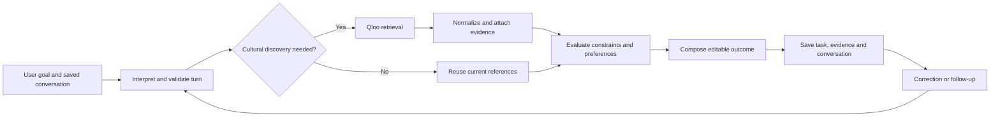
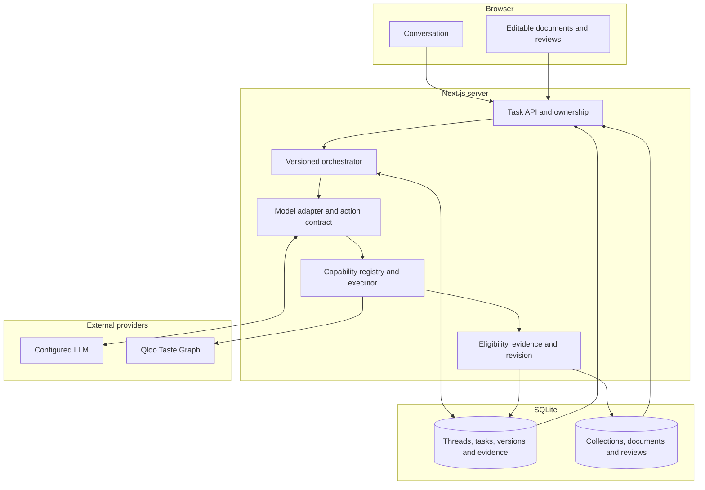
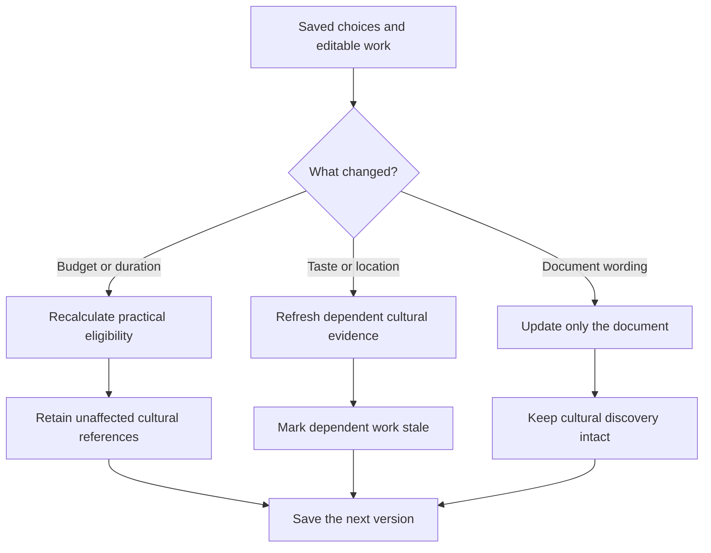

# Igor

<p align="center">
  <a href="https://igor-production-243e.up.railway.app/app">
    
  </a>
</p>

**AI agents are learning how to do almost anything. But how do they know what's right for you?**

Meet **Igor**, your agent with taste.

Start with something you love. A film, a song, a place, a feeling you can't quite describe. Tell Igor what you're trying to do with it. Igor helps you explore the connections, make a decision, and turn that decision into something you can use.

An evening with friends. A trip. An invitation. A creative direction. One conversation, with the decisions and work still there when you change your mind.

**The point isn't to give you another list. It's to help you do something with what you love.**

**[Try Igor](https://igor-production-243e.up.railway.app/app)** · **[See a real run](#one-conversation-two-decisions)** · **[Explore Qloo's role](qloo/README.md)** · **[Run it yourself](#run-it-locally)**

---

## One conversation. Two decisions.

Here's an actual exchange from Igor's **26 October 2026** production checks.

> **You:** "I like Portishead and Arrival. Find films for me for a quiet evening."

Igor queried Qloo, brought back **10 film references** with source-linked cultural evidence, and kept them in the task. It took **two live Qloo requests**.

Then the request changed.

> **You:** "Budget: 20."

Igor updated the constraint and kept the existing film reference pool. **No additional Qloo request was needed.**

| Observed in the production check | Result |
| :--- | :--- |
| Film references returned | **10** |
| Live Qloo requests for discovery | **2** |
| Qloo requests after the budget correction | **0** |
| Saved references after the correction | **Retained** |

This is the idea behind Igor: discovery should become a *decision you can keep working with*. The check proves that particular discovery-and-revision path, not every possible request. [Read the original run](docs/live-integration.md) or [inspect the Qloo evidence](qloo/EVIDENCE.md).

## Why we built Igor

We've all been there. A few friends want to make plans, you have a particular mood in mind, or you're trying to find the right cultural direction for a project.

Getting suggestions is easy. Choosing among them, checking whether they make sense, turning them into something tangible, and then revising everything when one detail changes is the actual work.

Most recommendation tools stop at discovery. Most chats forget how the pieces fit together.

**Igor keeps the connections between what you like, what you decide, and what you make.**

It uses [Qloo's Taste Graph](https://www.qloo.com/) for cultural understanding, but Qloo isn't an extra screen you have to visit. Its signals become part of a wider agent workflow: deciding which references matter, what fits the constraints, and how the result should change over time.

## From a reference to a result

You don't need to learn a tool menu to use Igor. Tell it what you want to achieve. The same engine can support different kinds of work.

| You could ask | Igor's supported outcome |
| :--- | :--- |
| "Help six friends agree on an evening." | Cultural references, attributed preferences, a programme and an editable invitation |
| "Make a three-day Tokyo itinerary." | Places, an itinerary and day allocations based on supplied planning facts |
| "Build a listening programme around my taste." | An artist-level programme with editable segments and transitions |
| "Help me develop a music direction." | Cultural references, supporting claims and a creative direction |
| "Turn these references into a brief." | An editable document linked back to its sources |

These aren't five hardcoded chatbots. Igor combines four capabilities within the same conversation:

**Discover** what connects culturally. **Evaluate** against what you know. **Collaborate** across different people's preferences. **Compose** the result into work that can be edited.

[Explore the supported outcomes](docs/broader-outcomes.md)

---

## How Igor works



1. **Understand the goal.** The model interprets a free-form request using saved conversation context. It can propose an action, reply or clarification.
2. **Validate before executing.** The server checks action contracts, ownership, task version and available capabilities. Missing information is a question, not a fabricated answer.
3. **Discover with Qloo when relevant.** Cultural entities and connections are resolved through the Qloo provider. Existing evidence can be reused when a correction needs no cultural refresh.
4. **Evaluate and compose.** Cultural relevance is kept separate from the supplied facts needed to produce a feasible plan. The capability engine creates results and attaches supporting evidence.
5. **Persist and revise.** The next message sees the saved conversation, task dependencies, decisions and editable outcome.

[Full turn lifecycle](docs/architecture.md) · [Orchestrator source](src/core/orchestrator.ts)

## Architecture

Igor runs as one **Next.js App Router** application. The browser displays the saved workspace and submits edits; the server owns interpretation, cultural retrieval, capability execution, validation and persistent state.



| Boundary | Source | Responsibility |
| :--- | :--- | :--- |
| **UI and routes** | [`src/app/`](src/app/), [`src/components/`](src/components/) | Conversation, views and user edits |
| **Orchestrator** | [`src/core/orchestrator.ts`](src/core/orchestrator.ts) | Apply a turn, execute work, version its result |
| **Contracts** | [`src/core/contracts.ts`](src/core/contracts.ts), [`src/capabilities/contract.ts`](src/capabilities/contract.ts) | Validated actions, evidence and capability outputs |
| **Capability engine** | [`src/capabilities/executor.ts`](src/capabilities/executor.ts) | Reusable Discover, Evaluate, Collaborate and Compose execution |
| **Qloo adapter** | [`src/tools/qloo-live.ts`](src/tools/qloo-live.ts), [`src/tools/qloo-response.ts`](src/tools/qloo-response.ts) | Bounded retrieval, entity normalization and provenance |
| **Persistence** | [`src/data/store.ts`](src/data/store.ts), [`src/data/outcome-store.ts`](src/data/outcome-store.ts) | Saved tasks, messages, outcomes and reviews |

[Architecture reference](docs/architecture.md) describes the full provider, ownership, evidence and failure boundaries.

## What the model does and what code enforces

A convincing answer is not necessarily a feasible outcome. Igor separates what a model **suggests** from what the application can **accept and commit**.

| Model-driven | Server-validated |
| :--- | :--- |
| Interpret the message and propose an action | Check typed actions and reject unsupported operations |
| Reply or ask for clarification | Preserve the existing task without inventing new work |
| Explain cultural references and write prose | Keep source identity, freshness, attribution and evidence |
| Suggest plans or revisions | Check eligibility, constraints, dependency changes and task versions |
| Work with a conversation's context | Restrict provider access and keep credentials on the server |

The model cannot grant itself a new tool, verify an unknown venue price, or silently turn an affinity into a reservation. These contracts reduce unsupported actions; they do not guarantee that every model explanation is semantically accurate.

[Execution contracts](src/core/contracts.ts) · [Provider boundaries](docs/architecture.md)

## Why Qloo makes a difference

A film, an artist and a place don't need to belong to the same category to share a cultural connection. Qloo gives Igor a way to follow those connections using taste data rather than relying on the language model's associations alone.

The Qloo provider resolves entities and retrieves cultural results through `/search` and `/v2/insights`. The agent can use those results as evidence for discovering and comparing options, then work with practical constraints and user decisions separately.

The critical boundary is simple:

> **Qloo provides cultural signals. Igor turns them into connected decisions and editable work.**

A cultural connection isn't a verified price or reservation. Igor retains provider identity, retrieval status and evidence limits instead of presenting them as practical facts.

[Qloo integration dossier](qloo/README.md) · [Provider adapter](src/tools/qloo-live.ts) · [Source handling](src/tools/qloo-response.ts) · [Evidence and evaluation](qloo/EVALUATION.md)

## Change the brief. Not everything else.

What if the budget changes after you've chosen a film? What if someone wants different music? What if you only want to edit the invitation?

Igor tracks the dependencies between cultural references, constraints and saved outputs. A budget change can reuse existing discovery; a changed cultural preference can trigger fresh exploration. An invitation edit shouldn't erase your earlier selections.

This connected-work model also supports a six-person gathering, a multi-day itinerary, an artist-level listening programme and reference-based creative research.

[See what the engine supports](docs/broader-outcomes.md) · [Read the architecture](docs/architecture.md)



The dependencies between facts, cultural references, decisions and artifacts determine what becomes stale. Manual edits and unrelated approved work should not disappear because another constraint changed.

[Revision implementation](src/core/revision.ts) · [Connected-work verification](docs/connected-work-validation.md)

## Try it yourself

There isn't a special judge-only route. The live app is the product.

1. **[Open Igor](https://igor-production-243e.up.railway.app/app)** and start a conversation.
2. Ask: `I like Portishead and Arrival. Find films for me for a quiet evening.`
3. Inspect the returned references and their cultural evidence. A result can be marked `LIVE` or `CACHED` depending on whether it was retrieved or reused.
4. Say: `Budget: 20`. See how the saved task responds.
5. Reload your thread and ask Igor to recall the earlier request.
6. Compare your experience to the [dated production checks](docs/live-integration.md), then follow the [Qloo code path](qloo/WORKFLOW.md).

Live-provider availability and the current application's behavior may differ from the historical check. That difference is something a judge should be able to see, not something the README conceals.

## Evidence you can inspect

The repo is more than a product description. It includes the actual provider integration, typed capability contracts, saved-work implementation, tests and dated execution records.

| Evidence | Where |
| :--- | :--- |
| Live Qloo discovery, budget revisions and conversation continuity | [Production integration checks](docs/live-integration.md) |
| Source-linked retrieval and its limits | [Qloo evidence](qloo/EVIDENCE.md) |
| Model decisions and constraint boundaries | [System architecture](docs/architecture.md) |
| Saving decisions, documents and targeted revisions | [Connected-work verification](docs/connected-work-validation.md) |
| Qloo versus no-Qloo comparison methodology | [Blind evaluation framework](qloo/EVALUATION.md) |

An evaluation harness exists, but we don't claim human preference lift without completed observations. The dated execution checks establish specific behaviors, not that every workflow works perfectly.

---

## Run it locally

Use **Node.js 24+**.

```bash
git clone https://github.com/Davemafy/ighor.git
cd ighor
npm ci
```

Configure your keys in the **server environment** (never a `NEXT_PUBLIC_` secret):

```dotenv
QLOO_API_KEY=your_key
GEMINI_API_KEY=your_key
```

Then run:

```bash
npm run dev
```

Open [http://localhost:3000/app](http://localhost:3000/app). For optional model providers, database storage and request limits, see [development setup](docs/development.md).

## Testing and reproducibility

```bash
npm test
npm run test:eval
npm run typecheck
npm run lint
npm run build
```

A fuller `npm run verify:all` also invokes formatting and browser verification, with extra environment prerequisites. The public checkout does **not** include original compressed Qloo response recordings because redistribution rights have not been established. Recording-dependent replay suites therefore require authorized private fixtures and must not be described as passing in this checkout.

| Evidence | What to inspect |
| :--- | :--- |
| [Railway integration checks](docs/live-integration.md) | Dated live Qloo discovery, revision and conversation findings |
| [Provider contract checks](docs/github-validation.md) | Independent requests and known failures |
| [Qloo evidence dossier](qloo/EVIDENCE.md) | LIVE versus CACHED observations |
| [Blind evaluation tooling](scripts/igor-blind-eval.mjs) | A framework to compare Qloo and a non-Qloo baseline |
| [Public test config](tests/vitest.config.mts) | Explicit exclusion of recording-dependent suites |

The blind evaluation tooling is tested. **That is not evidence of a completed human preference study or measured uplift from Qloo.**

## Project layout

```text
src/
  app/            App Router pages and server routes
  components/     Workspace and editable UI
  core/           Conversation orchestration and revision rules
  capabilities/   Typed task capabilities and execution
  tools/          Qloo, model and provider adapters
  data/           SQLite task and outcome stores
qloo/             Qloo integration, evidence and evaluation guides
tests/            Unit and browser tests
scripts/          Verification and evaluation tools
docs/             Architecture, outcomes and production checks
```

Start with [the orchestrator](src/core/orchestrator.ts), [Qloo provider](src/tools/qloo-live.ts) or [Qloo dossier](qloo/README.md).

## What we're exploring next

Richer ways to explore cultural connections, deeper shared decision-making, permission-based integrations that move from plans to actions, and blinded evaluations of what Qloo adds to completed outcomes.

## A note on boundaries

Igor doesn't currently book venues, send invitations or independently verify live prices, opening hours and availability. The public repository also omits original Qloo response recordings while their redistribution rights remain unresolved; recording-dependent tests need authorized fixtures. The [development guide](docs/development.md) and [evaluation notes](qloo/EVALUATION.md) explain these boundaries.

## ❤️ Thank you, Qloo

Thank you to the **Qloo team** for putting cultural intelligence into builders' hands and giving us the chance to ask what an agent could do if it understood more than instructions.

**Igor. Your agent with taste.**