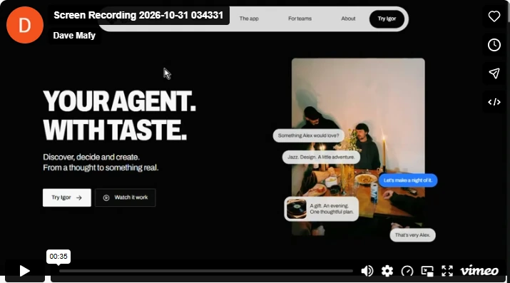
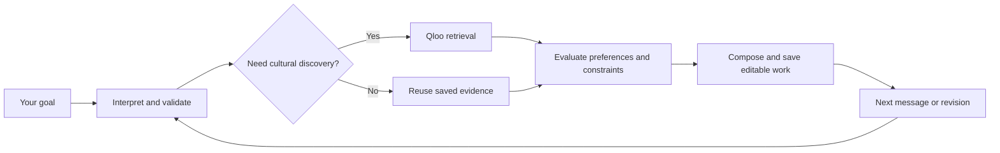
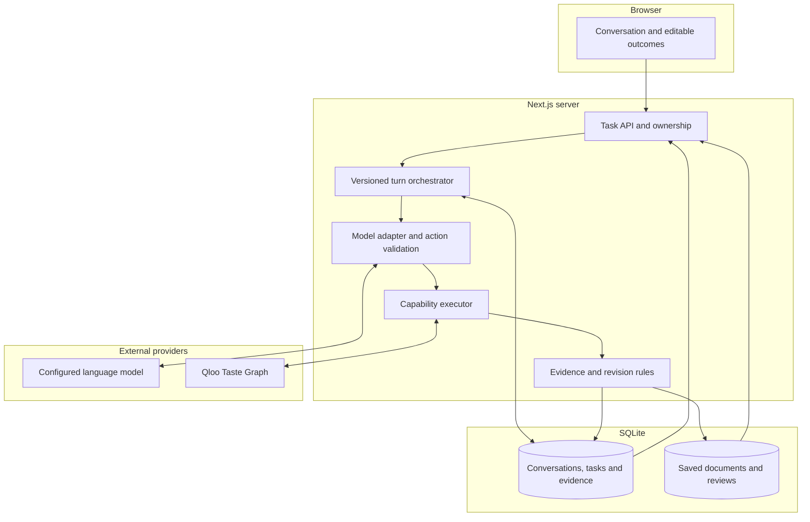
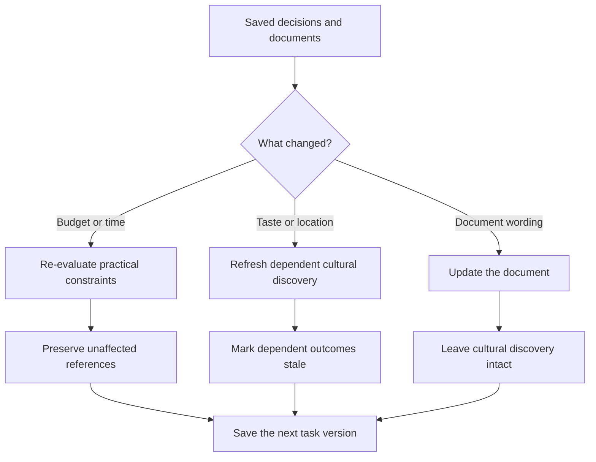

# Igor

<p align="center">
  <a href="https://igor-production-243e.up.railway.app/app">
    
  </a>
</p>

**AI agents can do almost anything. But how do they know what's right for you?**

Igor is your agent with taste. Tell it what you love, what you're planning, and who it's for. It helps you find the connections, make sense of the options, and turn a conversation into something useful. **And when your plans change, your work doesn't have to disappear.**

**[Try Igor](https://igor-production-243e.up.railway.app/app)** · **[Watch the video](https://vimeo.com/1241571941)** · **[How it works](#how-igor-works)** · **[Qloo integration](qloo/README.md)**

<p align="center">
  <a href="https://vimeo.com/1241571941">
    
  </a>
  <sub>▶ Watch Igor's product video on Vimeo. Click the preview to play.</sub>
</p>

---

## What would you ask Igor?

| You say | What Igor can help you do |
| :--- | :--- |
| **"I love Portishead and Arrival. Find films for a quiet evening."** | Explore films through cultural connections backed by Qloo evidence. |
| **"Actually, change the budget."** | Update the constraint while keeping unaffected discovery and decisions. |
| **"Help six friends plan an evening."** | Compare individual interests, put together a programme, and draft an editable invitation. |
| **"Turn these references into a creative direction."** | Develop an editable brief with its cultural references attached. |

These are supported kinds of work, not a claim that all four examples have passed fresh live acceptance on the current deployment. [See implemented outcomes and limits](docs/broader-outcomes.md).

## One small change. No restart.

On **October 26, 2026**, Igor was tested on a deployed Railway runtime. The operator asked for films connected to **Portishead** and **Arrival**. Igor returned **10 film references** with **LIVE Qloo evidence**.

Then the operator said:

> **Budget: 20.**

Igor updated the constraint, kept the film reference pool, and made **zero additional Qloo requests**.

| What happened | Observed |
| :--- | :--- |
| Film references returned | **10** |
| Live Qloo requests for initial discovery | **2** |
| New Qloo requests after budget correction | **0** |

That's the behavior we're building around: **discover what fits, make something with it, and change your mind without losing the useful parts.**

[Read the original production check](docs/live-integration.md) · [Inspect the Qloo evidence](qloo/EVIDENCE.md)

## How Igor works

Igor isn't four different assistants pretending to be one. It has four reusable capabilities within the same conversation: **Discover, Evaluate, Collaborate, Compose**.



A request starts with ordinary language. The agent proposes actions, typed contracts validate them, and the capability engine executes the work. Cultural discovery comes from Qloo when it's needed. The resulting references, decisions and documents belong to the **same saved task**.

### Who decides what?

| The model helps with | The application enforces |
| :--- | :--- |
| Understanding a request | Typed actions, permissions and task versions |
| Explaining cultural connections | Source identity and evidence validity |
| Proposing ideas and edits | Eligibility, constraints and dependency changes |
| Writing natural-language outcomes | Persistence and rejection of unsupported operations |

**A cultural connection isn't proof that a venue is open, a ticket is affordable, or a person will love something.** Igor keeps those claims separate.

## System architecture

The browser is the workspace. A Next.js server handles validated turns, provider calls and persistent state. Qloo supplies cultural intelligence, while SQLite stores versioned tasks and saved work.



| Want to inspect... | Start here |
| :--- | :--- |
| How a message becomes work | [Agent orchestrator](src/core/orchestrator.ts) |
| Cultural retrieval and its limits | [Qloo adapter](src/tools/qloo-live.ts) |
| Validated provider responses | [Qloo response contracts](src/tools/qloo-response.ts) |
| Typed capabilities and actions | [Capability contracts](src/capabilities/contract.ts) |
| Saved work and revision rules | [Architecture notes](docs/architecture.md) |

The root-level [`qloo/`](qloo/README.md) directory contains the integration walkthrough, [dated evidence](qloo/EVIDENCE.md) and [evaluation approach](qloo/EVALUATION.md).

## Change your mind. Keep the rest.



A budget edit doesn't need to rerun an unrelated film search. A different taste reference may require fresh cultural evidence. Wording changes shouldn't erase an approved selection. These rules are part of the saved task model rather than instructions to simply regenerate the entire answer.

[Read the revision implementation](src/core/revision.ts) · [Connected-work verification](docs/connected-work-validation.md)

## Try it

1. [Open Igor](https://igor-production-243e.up.railway.app/app) and start a fresh conversation.
2. Ask: `I like Portishead and Arrival. Find films for me for a quiet evening.`
3. Look at the reference pool and the **LIVE** or **CACHED** source labels.
4. Say `Budget: 20`, then inspect what changed. Reload the thread to explore what was saved.

The current runtime may differ from the October 26 check. For a source-grounded comparison, use the [production notes](docs/live-integration.md). There is no dedicated judge-only route or guaranteed replay.

## For developers

<details>
<summary><strong>Run Igor locally</strong></summary>

Requires **Node.js 24+**.

```bash
git clone https://github.com/Davemafy/ighor.git
cd ighor
npm ci
npm run dev
```

Open [http://localhost:3000/app](http://localhost:3000/app).

Live cultural discovery and conversation require `QLOO_API_KEY` and a supported model credential such as `GEMINI_API_KEY`, configured server-side. Never publish API keys through `NEXT_PUBLIC_` variables.

[Full development setup](docs/development.md).

</details>

<details>
<summary><strong>Tests and reproducibility</strong></summary>

```bash
npm test
npm run test:eval
npm run typecheck
npm run lint
npm run build
```

The public checkout omits original Qloo provider recordings because redistribution rights haven't been established. Recording-dependent replay suites cannot run without authorized fixtures. `npm run test:eval` checks the evaluation harness; it does **not** prove a completed human preference study or statistically significant Qloo uplift.

[Verification notes](docs/live-integration.md) · [Provider checks](docs/github-validation.md) · [Test selection](tests/vitest.config.mts).

</details>

<details>
<summary><strong>Project layout and known limits</strong></summary>

```text
src/
  app/            Pages and API routes
  components/     Conversation and editable workspace
  core/           Agent orchestration, evidence and revisions
  capabilities/   Discover, Evaluate, Collaborate, Compose
  tools/          Qloo and model adapters
  data/           SQLite storage
qloo/             Integration, evidence and evaluation guides
tests/            Unit and browser coverage
docs/             Architecture and production records
```

Igor does not automatically book venues, send invitations, purchase products or verify current opening hours, prices or availability. Historical production observations do not establish full acceptance of the current deployment.

[Supported outcomes](docs/broader-outcomes.md) · [Full architecture](docs/architecture.md).

</details>

## ❤️ Thank you, Qloo

Thank you to the **Qloo team** for making the Taste Graph available to builders and creating a space to explore what agents can do when they understand more than instructions.

**Igor. Your agent with taste.**

Built for the Qloo Agentic Hackathon.
