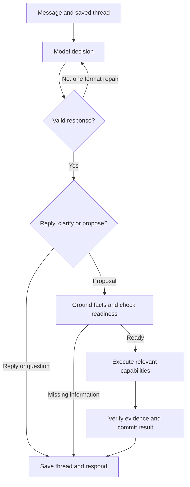

# Architecture

Igor is one Next.js App Router application. Server routes validate ownership and input; the browser edits task state and displays artifacts. SQLite persists local accounts, versioned tasks, explicit memory, saved collections and reviews. Provider adapters remain server-side.

## Runtime flow

The format-repair edge runs at most once and never retries transport failures. No cultural retrieval or planning edits run before decision validation. Missing user information is a question, not a provider failure.

| Boundary                         | Owner                                            | Failure behavior                                            |
| -------------------------------- | ------------------------------------------------ | ----------------------------------------------------------- |
| Thread access and version        | API and orchestrator                             | Reject unauthorised or stale edits                          |
| Model response contract          | `core/contracts.ts` and `tools/turn-protocol.ts` | One argument repair, then preserve state and report failure |
| Provider transport               | Gemini/OpenAI adapters                           | Bounded request; no automatic transport retry               |
| Planning readiness and grounding | `core/interpret-message.ts`                      | Ask for missing facts without partial edits                 |
| Capability execution             | Registry and executor                            | Bound work and retain provenance                            |
| Result integrity and persistence | Evaluators and task store                        | Validate evidence and reject late writes                    |

`LiveDecisionSchema` is the shared source for provider instructions and response validation. Both model adapters receive one JSON decision envelope, avoiding a separate hand-written provider schema. The engine distinguishes malformed model data, incomplete user requests and tool failures instead of treating them as the same interpretation error.

## Product and presentation contract

Igor is "your agent with taste": one conversational workspace that turns a person's goal into personalized outcomes using Qloo cultural intelligence. Discover, Compose, Collaborate and Evaluate are reusable capabilities within that workspace. They are not separate products or a requirement for users to choose a tool before describing a goal.

The engine owns interpretation, validated task state, capability execution, evidence, eligibility, dependency invalidation and persistence. The visual layer owns layout, typography, motion and how people inspect or edit those results. A new presentation must consume the same contracts and submit the same actions without recreating ranking, eligibility or revision rules in components.

| Integration surface               | Contract                                               |
| --------------------------------- | ------------------------------------------------------ |
| `src/core/contracts.ts`           | Validated task, action, evidence and event schemas     |
| `src/components/workspace-api.ts` | Browser requests and streamed turn events              |
| `src/components/use-workspace.ts` | Existing browser task lifecycle and pending state      |
| `src/tools/interfaces.ts`         | Server provider boundaries independent of presentation |
| `src/core/orchestrator.ts`        | Versioned execution and persistence lifecycle          |

Important results must expose their supporting evidence and limitations. Qloo output, user-supplied facts, Igor inferences and unknown information must remain distinguishable through presentation changes. A provider explanation must not be presented as a verified practical fact. Cached results retain their original provenance and retrieval time.

A constraint correction changes only dependent work. Unaffected results retain their identity and evidence. Affected results become stale before replacement; failed retrieval must not make an old result appear current. Ambiguous edits ask for clarification rather than applying part of a guessed correction. Concurrent turns retain version checks.

`core/inspect-result.ts` provides a read-only evidence inspection projection for candidates and artifacts. It retains source, delivery, timestamps and limitations, reports dangling evidence IDs and treats stale supporting evidence as stale output. Views must not convert this projection into stronger factual claims. `EventSchema` validates streamed task snapshots; incomplete streams surface an error instead of reporting completion.

Visual work may add views over structured results and controls over existing actions. A new interaction that needs a new domain operation requires a validated engine action and its dependency rules before a component can implement it. Credentials, storage and provider calls remain on the server.

Acceptance requires more than a polished response: inspect a result's sources, change a constraint, observe the affected dependencies, preserve unrelated work and handle unavailable evidence explicitly. Recorded checks and live provider checks must be reported separately. The current practical-facts adapter validates supplied facts; live venue verification remains unfinished.

## Turn lifecycle

Fresh live workspaces contain no sample participants, tastes or results. The sample starting points explicitly create a labelled example instead. Before cultural retrieval, the planner requires a supplied cultural reference or an existing context anchor. Missing taste becomes a question while retaining the goal and supplied locality. Shared statements can create a group taste profile; that profile does not establish individual agreement or consent.

The home result view exposes the persisted conversation transcript, including evidence attached to earlier replies. Later edits can make a cited source stale; the transcript displays its current freshness rather than treating the earlier answer as newly verified.

`src/core/orchestrator.ts` owns the versioned lifecycle: load, apply the input, publish stale outputs, execute work and save the result. It is the place to start when following a request.

| Module                 | Responsibility                                                                                   |
| ---------------------- | ------------------------------------------------------------------------------------------------ |
| `apply-turn.ts`        | Apply structured edits and identify the dependencies they change                                 |
| `interpret-message.ts` | Validate model interpretations, ground proposed edits and ask for missing information            |
| `compare-model.ts`     | Run baseline and Qloo-assisted rankings over the same candidate pool                             |
| `execute-plan.ts`      | Resolve identities, retrieve options, check eligibility, compare preferences and compose outputs |

`conversation.ts` applies a validated batch on a clone through named handlers for constraints, preferences, facts, identities, selections and documents. Ambiguity discards the whole batch.

Natural requests can create personal or named taste profiles through the validated `profile` conversation action. The first real profile replaces demo participants; subsequent profiles retain existing real people. Preference values and names must occur in the user message. Creation shares correction grounding and remains atomic with the rest of the turn. Asking for a missing locality preserves the supplied profile. No profile is saved to persistent memory without explicit approval.

`core/turn-reply.ts` describes current result names, artifacts, evidence delivery and open questions from committed state. It does not generate practical facts or describe stale outputs as ready.

Every live message receives a model turn decision: conversation, clarification, goal or revision. Conversation and clarification responses have their own schema and cannot mutate planning state. They retain messages and validated references to same-thread evidence with its freshness, through the same ownership and version checks, without cultural requests or dependency invalidation. `kind: conversation` messages are displayed as replies. Credential-free development replies remain explicitly scripted in `tools/development-replies.ts`.

`tools/model-context.ts` rebuilds context from the current saved thread, including its messages, constraints, profiles, current results, evidence, artifacts and unresolved questions. Ordinary histories are passed in full. Long histories have a bounded recent window plus relevant older messages, with an explicit omitted-message count so the model can ask when context is missing. Owner credentials and other threads are excluded. Refreshing or reopening a conversation restores its persisted messages as well as its goal.

Input handlers prepare task changes. They do not save to the database. The orchestrator commits stale outputs before provider calls, then saves the completed turn with an optimistic version check. A late result cannot overwrite a newer correction.

The browser follows the same separation. `components/workspace.tsx` arranges the interface. `use-workspace.ts` owns loading and turn state; `workspace-api.ts` handles HTTP and streamed events. `programme-view.tsx` renders the working result, and `workspace-panels.tsx` contains the brief and execution details.

Receipts retain version ranges, changed dependencies, input hashes, actual request counts, output references and outcomes. Each task keeps up to forty receipts and one hundred trace entries.

## Capabilities

| Capability  | Responsibility                                                          |
| ----------- | ----------------------------------------------------------------------- |
| Discover    | Resolve entity identities and retrieve typed cultural candidates        |
| Evaluate    | Apply practical eligibility and evidence/claim integrity rules          |
| Collaborate | Preserve participant attribution and compare competing preferences      |
| Compose     | Calculate programmes/reference outcomes and generate editable documents |

`capabilities/contract.ts` and `executor.ts` validate inputs and structured results. `core/execution.ts` bounds actions and waiting time. Models cannot introduce arbitrary URLs, tools or permissions.

`outcome-composer.ts` calculates selections. `outcome-document.ts` renders their text. `outcome-integrity.ts` checks references, citations, transitions, day allocations and totals. This keeps presentation separate from eligibility decisions.

## Evidence and constraints

Evidence records distinguish user inputs, external verification, provider output, recordings and illustrative examples. They retain entity identity, retrieval time, limitations and dependencies. A fixture is never labelled live. Query metadata, provider explanation contributors and application rationales remain distinct.

Cultural affinity does not establish cost, duration, availability, rights or commercial fit. Missing practical facts remain unknown. Schedules use only eligible options with current cultural and practical evidence. Research and music directions may retain unreviewed references, with caveats, without scheduling them as activities.

Group comparison uses per-query ranks and coverage, not raw affinities across independent calls. Missing affinity is unknown, not dislike. A context-anchor association is not a participant preference.

## Revisions and persistence

Dependency IDs connect facts, preferences, evidence, candidates and artifacts. Budget and allowance changes recompute affected decisions without rediscovery. Taste and location changes refresh dependent retrieval. Document-only edits do not call cultural discovery. Stale artifacts remain visibly stale.

`data/store.ts` saves tasks and approved memory atomically with optimistic version checks. Recall targets a named participant; preferences are never silently persisted. Legacy reads conservatively mark old decisions stale. `data/outcome-store.ts` saves frozen references, independent board revisions, scoped review proposals and expiring revocable links. Guest proposals require owner acceptance through the normal turn pipeline.

Local accounts use salted scrypt passwords and expiring server-mapped sessions. They provide no email recovery or verified identity service. Private document snapshots omit raw profiles, messages and traces; owner-authored text still requires review before sharing.

## Provider boundaries

`tools/interfaces.ts` defines cultural, practical-facts and model providers. `qloo-live.ts` owns requests, identity resolution and request caps. `qloo-response.ts` validates response shapes and converts results into candidates and evidence. `qloo-cache.ts` owns the in-memory and SQLite caches. `response-body.ts` enforces streamed byte limits and releases readers on success and failure. Recorded mode uses one losslessly compressed fixture through `recording-file.ts`; provider validation is unchanged. Synthetic providers remain confined to regression tests.

Gemini and the optional OpenAI adapter share a bounded tool protocol. Credentials stay server-side. The current practical-facts provider checks supplied values; it does not verify live venues. Exact-runtime live integration and human relevance remain separate from local correctness tests.

The Keep & share view composes collections, review sharing, approved memory and blinded assessments. `use-saved-outcomes.ts` owns those requests and their status. Client types for stored collections and reviews are derived from the storage schemas through type-only imports; server code stays out of the browser bundle.
